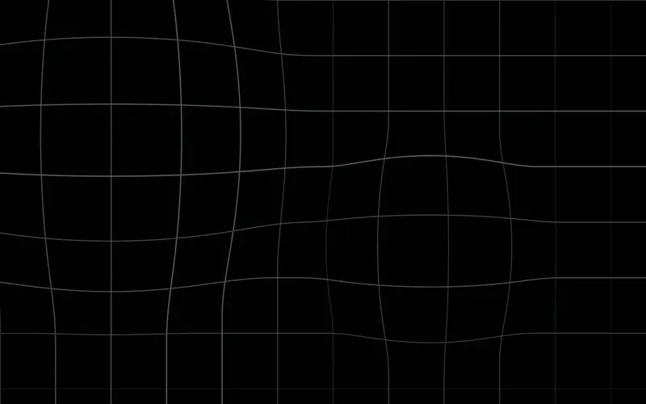
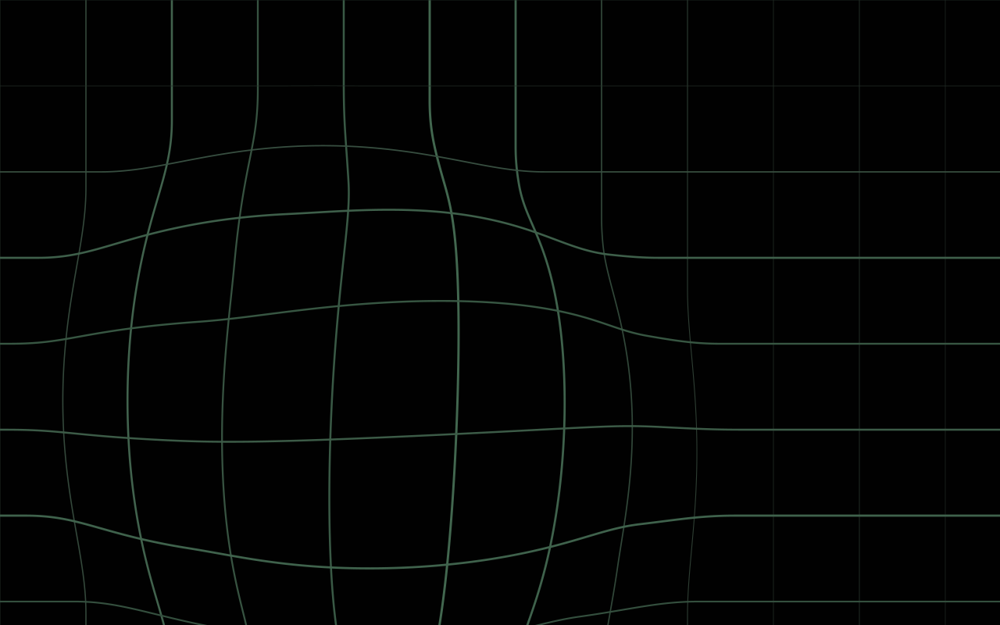
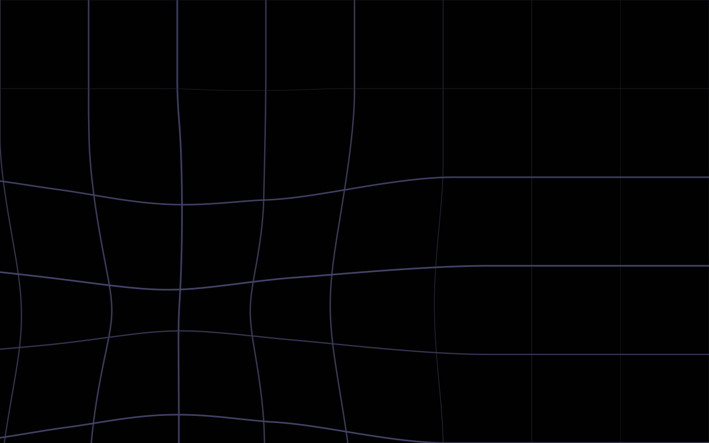
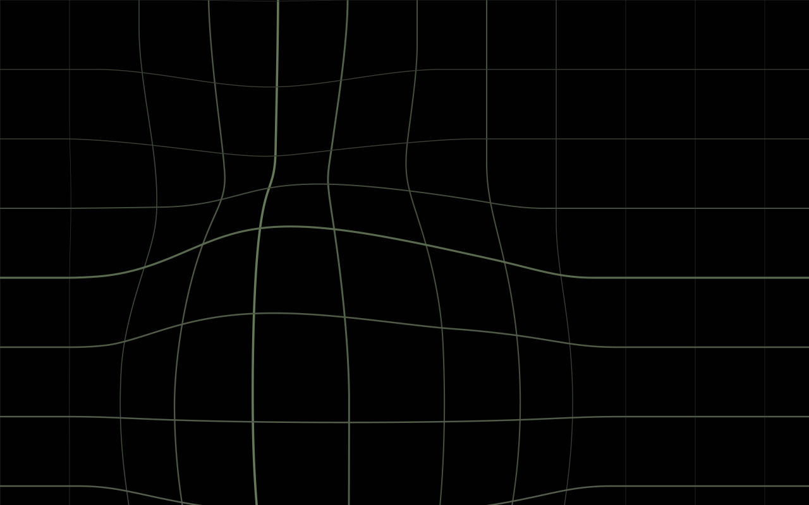
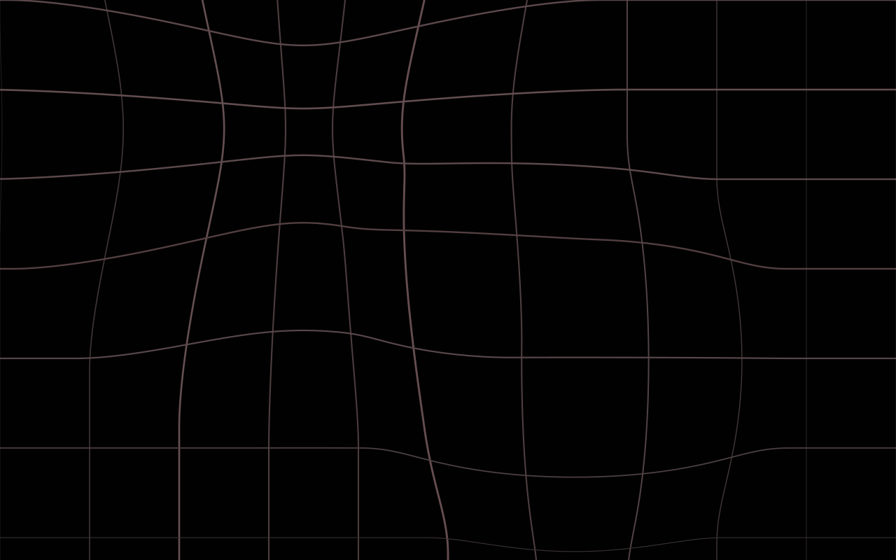
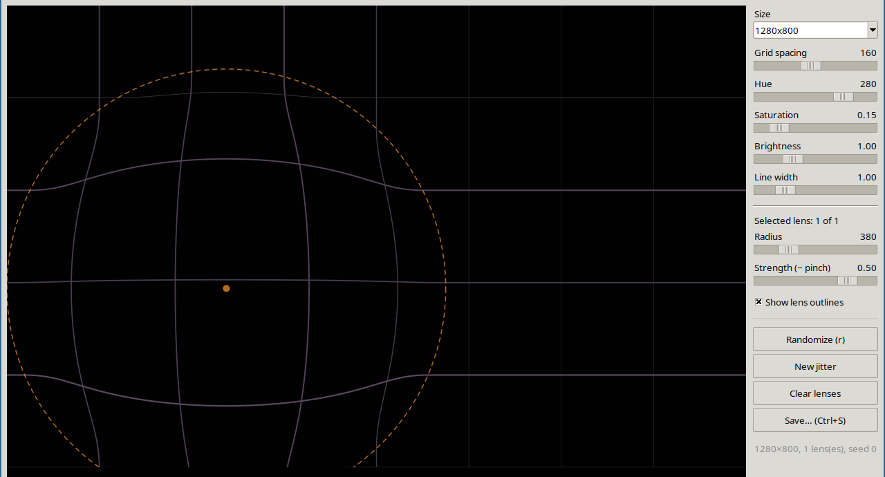

# warpman

Generates warped-grid wallpapers: a thin tinted grid on black, bent by smooth radial "lenses" that fade to zero at their radius. It comes with a still-image CLI, a live editor, and an animated version that also works as a sway lock screen.



<sub>8 s preview. Full 15 s clip at 1280×800: [docs/drift.mp4](docs/drift.mp4)</sub>

| | |
|---|---|
|  |  |
|  |  |

## Setup

```sh
sudo apt install python3-venv python3-tk python3-dev libcairo2-dev pkg-config   # Tk, plus headers to build pycairo
python3 -m venv .venv
.venv/bin/pip install -r requirements.txt
source .venv/bin/activate          # then ./warpman.py etc. run inside the venv
```

`requirements.txt` lists pycairo, Pillow, NumPy, moderngl and pywayland. moderngl is only needed for the GL backend, and pywayland only for the Wayland background client used by the lock screen (both below). Tk comes from the system (`python3-tk`), not from pip. `lock/drift-lock-bg.sh` uses `.venv/bin/python` automatically when it can import cairo, and falls back to the system `python3` otherwise.

## Still images

```sh
./warpman.py                              # one random 1280x800 PNG in out/
./warpman.py -n 8 --seed 42               # 8 reproducible variations
./warpman.py -W 1024 -H 768 --lenses 2 --hue 90
./warpman.py --pinch-chance 0.5           # some lenses pinch instead of bulge
./warpman.py --format svg                 # vector output
./warpman.py -h                           # all options
```

The four images above came from `./warpman.py -n 12 --seed 11 --lenses 2 --pinch-chance 0.3`, which produced seeds 14, 16, 19 and 22.

## How it works

Every grid line is sampled every 4 px. Each point is moved by the sum of all lenses:

```
t   = r / R                       (r = distance to lens centre, R = lens radius)
mag = strength * R * t * (1 - t²)²  for r < R, else 0
p  += direction_from_centre * mag
```

That falloff is zero at the centre and at the edge, with its peak near t ≈ 0.45. So the warp blends smoothly into the straight grid around it. The more a line bends, the thicker and brighter it's drawn. A negative strength pinches instead of bulging.

## GUI

```sh
./warpman_gui.py
```



The preview updates live as you change things.

- **Click** empty space to add a lens. **Drag** a lens to move it.
- **Mouse wheel** resizes the selected lens. **Shift + wheel** changes its strength; negative values pinch instead of bulge.
- **Right-click** a lens to delete it.
- The sliders set grid spacing, hue, saturation, brightness, line width, and the selected lens's radius and strength.
- Shortcuts: `r` randomizes, `Delete` removes the selected lens, `Ctrl+S` saves a PNG or SVG at full resolution.

## Drift (animated)

```sh
./warpman_drift.py                 # windowed
./warpman_drift.py --fullscreen    # screensaver mode
./warpman_drift.py --speed 30 --lenses 2 --seed 7
```

There's no editor in this one, just the animation shown at the top. It starts from random settings, and the lens centres wander slowly. Each lens turns smoothly, changes speed and gently "breathes" in size and strength. The lenses are steered softly back whenever they drift near the edge.

### Backends

`--backend cairo` (the default) draws on the CPU. `--backend gl` renders on the GPU through headless EGL (moderngl, OpenGL 3.3). The undisplaced grid segments are uploaded once, and the vertex shader warps them every frame. Each segment is drawn as an instanced quad that MIN-blends its distance into a float texture, and a second pass turns those distances into antialiased lines. The CPU only picks each line's width and brightness. The result matches cairo to within a few levels of brightness, including where overlapping lenses fold the grid. If no GPU context can be made, `gl` prints a warning and falls back to cairo.

| 3840×1600, per frame | cairo | gl |
|---|---|---|
| plain tint | 16 ms CPU | 1.6 ms CPU (9 ms wall, mostly GPU and readback) |
| rainbow `wave` | 28 ms CPU | 1.6 ms CPU |

The editor (`warpman_gui.py`) and the still-image CLI always use cairo.

`--hue` and `--saturation` fix the tint for every scene instead of picking it at random.

Keys: `space` / `n` new random settings, `r` next rainbow mode, `s` mute (with `--sound`), `v` start / stop recording, `f` / `F11` fullscreen, `Esc` / `q` quit. Every scene prints its seed to stderr, so you can bring one back with `--seed`.

### Sound

`--sound` adds generative sound effects that follow the animation (`--volume`, default 0.5; `s` mutes):

- Each lens hums a note from a minor pentatonic scale, and the key follows the scene's hue. Its pitch comes from its size, so big lenses are low and small ones high. A lens is panned by its x position. Its tone gets brighter the harder it is bending the grid at that moment, and a little when it speeds up. It swells as it breathes. Pinching lenses add a sub-octave and sound darker.
- Where the warp squeezes the grid lines into a tight band (mostly where lenses overlap), a high tone shimmers. The tighter the squeeze, the louder it gets and the faster it beats. It is panned to where the squeeze is.
- A lens that heads toward an edge and turns back rings a soft bell at its position as it turns. The faster it was heading out, the louder the bell.
- A new scene hits with a downward swoosh on the frame where the picture cuts, and the drones switch over within about 0.15 s. Changing rainbow mode plays a short arpeggio. While a rainbow is on, each lens's tone follows the colour passing over it: reds sound darker and cyans brighter.

Everything is synthesised with NumPy in `warpman_sound.py`, through a stereo echo, and streamed as raw PCM to `pw-cat`, `pacat` or `aplay`, whichever is installed first. No extra Python packages are needed. It takes about 2.5% of a core. Sound only works in the window, not with `--raw`, and the lock screen stays silent.

The picture is held back to line up with the audio. With `pw-cat`, the app reads the stream's output latency from PipeWire every 3 s and delays the frames by that much. The delay is the device latency plus one graph quantum and a 43 ms pipe, minus the picture's own frame and vsync lag. A Bluetooth headset with AAC reports about 190 ms, for 267 ms in total. The figure is printed to stderr, and switching outputs is picked up. `--av-delay MS` sets the delay by hand, and `--av-delay 0` turns it off. The app keeps lens states rather than frames, so the delay costs no memory, even at 4K.

### Rainbow modes

`--rainbow MODE` colours the grid like an RGB keyboard instead of using one tint:

- `wave`: a rainbow band sweeps diagonally across the screen.
- `ripple`: rainbow rings spread out from the first lens and follow it as it drifts.
- `cycle`: the whole grid fades through the spectrum together.

`--rainbow-speed` sets the speed in spectrum cycles per second (default 0.1). In the window, `r` steps through off → wave → ripple → cycle. With the cairo backend the `wave` and `ripple` gradients cost about 70% more per frame; with the GL backend they are free.

### Recording a video

Press `v` in the window to start recording and `v` again to stop. The clip is saved as `out/drift-YYYYmmdd-HHMMSS.mp4` (change the folder with `--record-dir`) at the window's size and `--fps`. With `--sound`, the audio goes into the file too, lined up with the picture to within a frame. A red "● REC" marker shows while recording; it sits over the window and is not part of the video. Frames are written by the clock, so the clip plays at real speed even if drawing stutters. If the window changes size (for example with `f`), the current file is closed and a new one starts. `warpman_record.py` pipes the frames and sound to ffmpeg (libx264 and AAC), so ffmpeg needs to be installed.

For a clip that doesn't depend on the window, `--raw` writes headless BGR0 frames to stdout. The clip at the top was made like this:

```sh
./warpman_drift.py --raw -W 1280 -H 800 --fps 30 --seed 42 --lenses 2 |
  ffmpeg -f rawvideo -pix_fmt bgr0 -s 1280x800 -r 30 -i - -t 15 \
         -c:v libx264 -crf 20 -pix_fmt yuv420p -movflags +faststart docs/drift.mp4
ffmpeg -i docs/drift.mp4 -t 8 -vf "fps=20,scale=800:-1:flags=lanczos" \
       -c:v libwebp_anim -q:v 70 -loop 0 docs/drift.webp
```

## Lock screen (sway)

`lock/drift-lock-bg.sh` runs `warpman_layer.py` under [swaylock-plugin](https://github.com/mstoeckl/swaylock-plugin), which shows the live animation behind its password prompt. `warpman_layer.py` is the drift animation as a Wayland background client (wlr-layer-shell). It renders with the GL backend's shaders straight onto each monitor through EGL, so frames are never copied back to the CPU. Each monitor gets its own scene at its native resolution. At 3840×1600 and 24 fps it uses about 2% of a core. Frames are only drawn when the compositor asks for one, so nothing is rendered while a monitor is off.

On battery power the animation pauses: the last frame stays on screen, and it's only redrawn when the status text changes (about 0.1% of a core). It resumes when power comes back. Set `DRIFT_ANIMATE_ON_BATTERY=1` to keep animating anyway.

The script switches to a new scene every `DRIFT_SCENE_SECONDS` (default 300). The frame rate is set by `DRIFT_FPS` (default 24). The grid is always tinted green (`--hue 120 --saturation 0.5`); change it with `DRIFT_HUE` (0–360) and `DRIFT_SATURATION` (0–1). CPU usage and battery level are shown in small type in the bottom-right corner (refreshed every 2 s); set `DRIFT_STATUS=0` to hide them. Errors go to `$XDG_RUNTIME_DIR/warpman-lock.log`. If the client can't start, for example because there's no OpenGL 3.3, the lock screen shows its plain colour instead, and the script retries every 10 s.

swaylock-plugin isn't packaged for Ubuntu. Its source checkout lives in the repo root, and `.gitignore` excludes it. To build it, run this from the repo root:

```sh
sudo apt install meson ninja-build scdoc wayland-protocols libwayland-dev libxkbcommon-dev \
    libcairo2-dev libgdk-pixbuf-2.0-dev libpam0g-dev
git clone https://github.com/mstoeckl/swaylock-plugin.git
(cd swaylock-plugin && meson setup build && ninja -C build && sudo ninja -C build install)
sudo cp /usr/local/etc/pam.d/swaylock-plugin /etc/pam.d/   # PAM ignores /usr/local/etc
```

Then add this to the sway config:

```
set $lock swaylock-plugin -f -c 000000 --command /path/to/warpman/lock/drift-lock-bg.sh
exec swayidle -w timeout 300 '$lock' before-sleep '$lock'
bindsym $mod+BackSpace exec $lock
# recovery if the locker crashes (red screen):
bindsym --locked $mod+Ctrl+BackSpace exec 'pkill -x swaylock-plugin; $lock'
```

`swaymsg reload` doesn't restart `exec` lines, so restart swayidle yourself (or log out and back in) to pick up the new lock command.

`warpman_layer.py` also works as an animated wallpaper on its own. To try it above your windows for a few seconds (clicks pass through), run `./warpman_layer.py --layer overlay --duration 5 --status`. `wayland_protocols/` holds the generated pywayland bindings for wlr-layer-shell, which pywayland doesn't ship.

### Power use

Measured with `intel_gpu_top` on an Intel Iris Xe laptop, at 3840×1600 with the lock-screen settings. Each figure is the average of 16 one-second samples:

| Mode | GPU busy | GPU power | Package power |
|---|---|---|---|
| animating, 24 fps | 7% | 0.11 W | 8.2 W |
| animating, 15 fps | 4% | 0.07 W | 7.0 W |
| still (on battery) | 0.2% | 0.01 W | 5.8 W |

"Package" is the whole processor chip: CPU cores, GPU and memory controller. Single samples vary by about 1 W, so treat the differences as roughly ±0.5 W.

- The rendering itself costs almost nothing. The GPU runs at its lowest clock and adds less than 0.1 W, so rendering at a lower resolution wouldn't help.
- Animating costs about 2 W of package power compared with the still frame. Most of that is frame-rate driven: the CPU wakes for every frame, sway composites and pushes it to the display, and the chip spends less time in its power-saving states.
- The frame rate is therefore the main lever. `DRIFT_FPS=15` saved about 1.2 W against 24 fps.
- On battery the animation pauses anyway, so these watts are mostly spent while plugged in.

## License

MIT. See [LICENSE](LICENSE).
